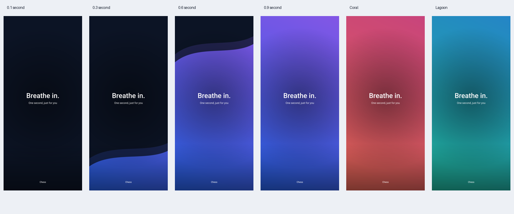

# Breathing, temporary pop-ups and updates — 15 November 2026

This supersedes every older request for a persistent camera island, including its “Off” ring. The starting default branch was `2e9e039863ab774d1a3820b25980d72146543dce`; the recent AirPods-first navigation and headphone improvements were preserved.

## What to do on the phone

1. Install the new, signed pro APK once over the existing app. Do not uninstall. This bootstrap adds the updater; older installations cannot acquire native services by refreshing data.
2. Open **Breathe → Choose apps & add shortcuts**. Search the real installed names, select your apps, and tap **Add icon** for each. Accept your launcher's add-to-home prompt. Use these breathing icons in place of the original home-screen icons. pro does not change your launcher or remove existing icons.
3. Use **Phone → App updates → Check now** to find a newer build. Download and Update stay inside pro. Allow pro to install apps once when Android asks. A foreground Update action opens Android's confirmation automatically if required. If you leave before it arrives, use Finish installation or the update notification. Auto-checks/downloads use unmetered network and idle periods; idle installation is optional. Checks are scheduled roughly every 12 hours, subject to Android's scheduler, never an exact delivery promise.
4. In **Breathe**, choose **Electric**, **Coral**, or **Lagoon** and optionally **Still color layer**. These choices are saved and used by both the real launch and preview; all last one second. The system reduced-motion preference also selects a still layer. Turning breathing on again clears a temporary pause.
5. Temporary headphone pop-ups use Display over other apps. Optional notification access supplies music names and controls. Breathing needs neither permission, no Accessibility access, and no Bluetooth connection. Permission status refreshes from Android when returning from Settings, including revocations. Notification prompts have a direct settings fallback; blocked music access has an App info route for restricted settings. Samsung Auto Blocker can prevent APK installation; pro reports this, without changing security settings itself.

## Exact launch coverage and timing

| Entry | Behavior |
|---|---|
| Added pro breathing shortcut | pro owns the activity before the destination is started. The first rendered breath starts a 1,000 ms monotonic deadline; only then is the destination's launcher intent sent. |
| Original home-screen icon / app drawer | Direct launch. No interception. |
| Recents / notification conversation / deep link | Direct launch. No interception or replacement intent; original destination and session remain Android's. |
| Returning among activities, keyboard, permission sheets, shade | No observation service; these cannot create another intervention. |
| Home, Back, screen lock, interruption | Cancels the pending launch. No deferred launch when returning or after process death. |
| Rotation, landscape, resized/split window | Same deadline; the view remeasures. A destroyed/restored activity cancels instead of resurrecting a destination. It blocks its own pane; another split-screen pane remains usable. Actual One UI behavior remains a phone check. |

One second refers to the intervention, from its first draw to destination launch request, not OS cold-start/splash/task-start latency or rendering delays. The app does not wait for an animation coroutine to finish and does not multiply the deadline with animator duration settings. A late main-thread dispatch or slow package lookup can still add platform latency; there is no claimed phone measurement. Shortcut completion uses the destination's normal launcher intent with no CLEAR_TASK/CLEAR_TOP flags, preserving an existing task under Android's normal launcher rules. Apps themselves may reset their own state on a launcher intent. No conversation/deep-link context is fabricated or replaced.

The production `BreathView` is also the preview. Rendered inspection caught and fixed painting beyond the preview bounds and large-text landscape spacing. Six actual native-rendered transition states are captured by `BreathScreenshots`; these are rendering evidence, not a frame-rate measurement. The flower was replaced at Jake’s request with a curved, full-screen color layer sweeping upward over the second, then handing straight to the destination. Three vibrant gradient palettes are saved independently of selected apps. Still mode uses the same full-color surface for the same deadline, based on the explicit switch or existing system/comfort preference. No infinite animation or exit delay is added. Color controls and action rows wrap on narrow screens or with large text. Intervention touches are consumed by its activity; system navigation remains available.

## Requirements and verification map

| Requirement | Implementation | Evidence / remaining check |
|---|---|---|
| Remove pill/ring, previews, gestures, screen/audio observation | Deleted MiniIsland controller, rules/look/gesture editors, accessibility component and screen readers; ordinary overlay windows only; migration retires camera keys | Manifest/code audit; `OverlayLayerTest`, `IslandHandoverTest`, migration test; phone must confirm upgrade removes old windows |
| Retain AirPods/Beats/music event pop-ups and controls | IslandController/IslandHost/MusicIsland, service triggers retained; music suppression by camera pill removed | Existing protocol, headphone, UI and popup screenshots retained; `PopupGate` test; radio/touch behavior needs phone |
| Keep pause clear | Existing windows removed synchronously; routine events dropped during pause, never queued; urgent timer/problem/heart alert cancels pause | Production gate; urgent-system and heads-up ordering needs One UI check |
| Real searchable installed apps, persistent choices | Launchable-app query and bounded icon cache off main; BreathPrefs; OS pinned shortcuts | Picker UI and shortcut checks; app removal fails safely; no guessed example package IDs |
| One second, no Continue or duplicate launch | BreathSession and BreathActivity own first frame/deadline; duplicate request guard | Actual activity/handler integration at 999/1,000 ms, cancellation/disable/duplicate/lock/restore tests; real cold/warm latency unmeasured |
| Customization, accessibility, layout, preview | Shared native renderer, saved Electric/Coral/Lagoon colors and Still switch, content description, font scaling, system motion preference, real preview | Real control clicks preserve choices/apps; actual activity applies appearance without changing its deadline; portrait/landscape renders; device TalkBack/rotation/split-screen checklist |
| Permissions remain accurate | Event-driven resume refresh for overlay, music, install and notification access; runtime notification callback refresh; direct app-specific settings | Lifecycle UI test grants and revokes all four accesses, then resumes; device/OEM settings routes remain phone checks |
| In-app updates and honest automation | JobScheduler, HTTP discovery/download, PackageInstaller self-update; optional constrained idle install | Controlled newer/missing/rate-limited/offline/republished/invalid fixtures; pending/success/failure tests; no real silent install claim |
| Package/version/signing compatibility | apksig cryptographic verification, SHA-256/size, real package/version, exact installed signer set | Policy and corrupt-download tests; release certificate checked against recovered key; Android upgrade-in-place remains device check |
| Stable/preview, reusable releases | Metadata generated from signed APK; immutable per-version APK plus channel metadata | Pipeline script and actual artifact metadata; never compare release title or versionName |
| Durable key, never regenerate | Existing identity recovered; workflow accepts secrets then original cache, pins public certificate, fails closed | Fingerprint matches downloaded build 228. Secret API returned 403; owner setup below remains |
| Energy and architecture | No breathing resident service, app polling or audio capture; sparse idle update job; scoped battery/torch/pop-up listeners | Lifetime/code audit and existing battery tests; no measured power-saving percentage |
| Delivery and regression | Headphones remain Home/default; recent AirPods controls/assets preserved | Unit/UI tests, lint, signed release build, and delivery record documented when observed |

## Research and choices

Official references were rechecked for API 37, with Samsung documentation used for OEM installation restrictions. Documentation establishes API behavior, not successful testing on Jake's specific handset.

- [Accessibility events](https://developer.android.com/reference/android/view/accessibility/AccessibilityEvent) describe UI changes. They are observations after the target changes, not a pre-launch veto. An accessibility overlay can react quickly but cannot establish the required before-target ordering across entry paths. Usage access/polling is later still and costs battery. Neither is shipped as a delayed “instant” fallback.
- [Pinned shortcuts](https://developer.android.com/develop/ui/compose/system/shortcuts/creating-shortcuts) let pro control the launch activity first, with explicit launcher confirmation. This is the chosen route. A replacement launcher could also control its app drawer, but would change the user's home-screen workflow and still would not own notifications or Recents. No launcher role or device-management privilege is requested.
- [Android 17 all-app changes](https://developer.android.com/about/versions/17/behavior-changes-all), [targeted changes](https://developer.android.com/about/versions/17/behavior-changes-17), and [background activity rules](https://developer.android.com/guide/components/activities/secure-bal) do not grant Bluetooth apps interception powers. No broad launch guarantee is inferred from them.
- [PackageInstaller require-user-action](https://developer.android.com/reference/android/content/pm/PackageInstaller.SessionParams#setRequireUserAction(int)) expressly includes self-updates among eligible unattended updates. On Android 17 the target APK must target at least API 35; pro targets 37 and declares UPDATE_PACKAGES_WITHOUT_USER_ACTION and REQUEST_INSTALL_PACKAGES. Update ownership/installer-of-record enforcement and OEM restrictions may still lead to pending user action. The receiver always handles that outcome. No root or Play Core flow is assumed.
- [Install constraints](https://developer.android.com/reference/android/content/pm/PackageInstaller#commitSessionAfterInstallConstraintsAreMet(int,android.content.IntentSender,android.content.pm.PackageInstaller.InstallConstraints,long)) allow automatic replacement to wait for idle/no-call/no-interaction on API 34+. If Android refuses the caller's installer ownership, pro retains the APK and offers the manual action. Manual installation is user initiated and may restart pro, including a heart-recording session; finish important recording before tapping Update.
- [Samsung Auto Blocker](https://www.samsung.com/us/support/answer/ANS10003636/) can block apps from outside approved stores. The app cannot promise to bypass it or silently adjust it.
- [Obtainium's tracking/install documentation](https://wiki.obtainium.imranr.dev/app_tracking/) supports background updates with conditions and version-code options. It is a reasonable external alternative, but would require another app and per-app source/channel setup. A built-in updater uses the known single repository, actual numeric versions and installed certificate, reducing this user's routine effort. Play Core in-app updates do not service this GitHub APK distribution.
- [one sec's intentional switching](https://tutorials.one-sec.app/en/articles/3310146) is a useful grace-period reference, not evidence of before-target interception. A genuine “time since leaving app” grace period would require observation privileges; it is deferred. A 15-minute pause and optional Quick Settings switch provide lightweight relief now. Schedules and a study dashboard are deferred.
- Future study restriction belongs ahead of breathing in the controlled launch policy, so they do not stack. Ordinary consumer apps cannot truly suspend arbitrary packages across every entry path. [DevicePolicyManager package suspension](https://developer.android.com/reference/android/app/admin/DevicePolicyManager#setPackagesSuspended(android.content.ComponentName,java.lang.String[],boolean)) requires device/profile owner or delegated management powers, with personal-device setup consequences. An accessibility blocker remains bypassable and reacts after launch. [Modern DND rules](https://developer.android.com/reference/android/app/NotificationManager#setInterruptionFilter(int)) generally activate an app-owned AutomaticZenRule for target 35+, rather than unconditionally changing the global filter. No study system or management enrollment is built here.

## Signing continuity — one owner action

The existing release certificate is `9dcdd1402e7eff958007957933847bf23bfcac1ec99a500a0b041ee07c159d94`. The recovered key matches build 228's downloadable APK. Nothing generates or commits a replacement key.

The connected GitHub installation returned HTTP 403 for both listing secrets and obtaining the secret-encryption public key. The owner must add **PRO_SIGNING_KEY_B64** and **PRO_SIGNING_PASSWORD** at [repository Actions secrets](https://github.com/Jbyjre/pro3/settings/secrets/actions), using the correspondingly named text files in the privately delivered signing backup. Open each file, copy all its contents, and paste it as the secret value. No terminal is needed. Keep the backup private and outside GitHub issues/releases. Until then the existing cache remains the release fallback; if lost, the build stops rather than breaking upgrades.

Only downloaded configuration/data can refresh without installation. Kotlin/Compose/native services, permissions and manifest changes require a signed APK update and Android process replacement. There is no remote native-code loader, web conversion, account, or new cloud backend.

## Observed verification

- Full regression run: **361 tests, 49 classes, zero failures/errors/skips**, including retained AirPods/Beats/UI/popup/shape/battery/heart coverage and the new launch/update/APK fixtures.
- Customization and permission tests click the real color/Still controls, preserve selected apps, apply saved appearance to the real launch, and grant/revoke four Android accesses across lifecycle resumes. Still mode and system animation scales 0×/10× retain the 999/1,000 ms deadline. Timer restoration permits under 100 ms of wall-clock conversion jitter.
- Production render states: 36 portrait/light/dark/landscape-large-text and palette frames, plus setup-page and popup screenshots. Rendered evidence led to bounded preview painting, direct reuse of the native paint path from Compose, and responsive landscape typography and brighter, localized shading. These do not measure device frame rate.
- Local environment: JDK 21, Gradle 9.4.1, Android compile/target 37.0/API 37, NDK 29.0.14206865 and CMake 4.1.2 via the supported offline setup; Robolectric API 36. CI uses its configured NDK 30. No emulator or physical Samsung was attached (`adb devices` was empty).
- Release identity: package **io.github.jbyjre.glint**, versionName **1.0.0**, numeric build **233**. Downloadable prior stable **228** and the recovered release key have the identical certificate fingerprint above. The phone's currently installed build was not read.

Silent install, physical upgrade-in-place, One UI overlays/gestures, exact cold/warm startup latency, destination-app state and smoothness remain device checks in TESTING.md. No measured Samsung timing or battery gain is claimed.

Final local lint and signed release rebuild passed after the color layer, customization and permission changes: **0 lint errors**. APK SHA-256: `cac2f14db5a096f62e4f23e888b831c545249585b9af954cab8430b487a14092` (10836672 bytes). Workflow YAML/shell syntax and metadata generation from the prior signed APK also passed.
