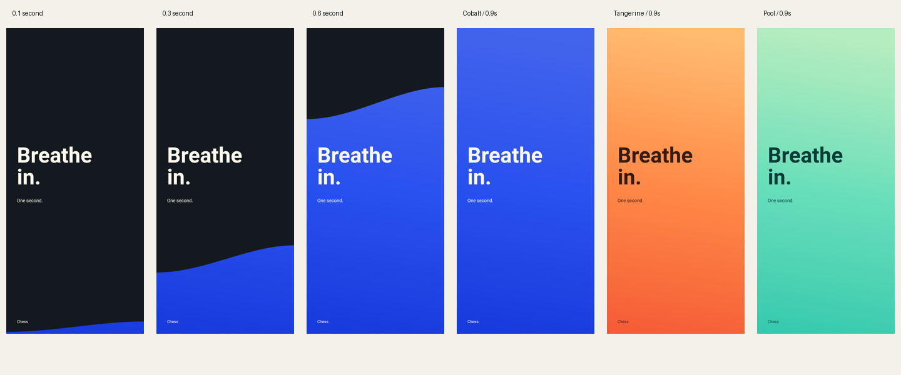

# Color and motion pass — 15 November 2026

Jake asked for another researched pass: pop colors and gradients with a more deliberate visual identity. This revises the breathing surface and its color controls. Headphone artwork and the rest of the app retain their existing identity.

## Research and the resulting decisions

- [Google Design’s expressive-design research](https://design.google/library/expressive-material-design-google-research) treats color, shape, size, motion and containment as a coordinated system that draws attention to useful actions. The primary article and its visual examples were inspected. Here, one moving sheet communicates the one-second pause, with a consistent alignment for instruction and destination.
- [Headspace’s lead designer on its design system](https://www.sczepanik.com/headspace) distinguishes expressive color from functional neutrals and emphasizes clear type, contrast and simple motion. Its actual palette and Google’s visual examples were viewed. This informs the separation of a neutral setup page from three strongly differentiated color families; no Headspace artwork, font or palette was copied.
- [W3C’s color-interpolation discussion](https://www.w3.org/TR/css-color-4/#interpolation-space) describes Lab and Oklab as suitable for perceptually even interpolation. Each authored palette uses three related hue stops, sampled in Lab through the existing AndroidX color utility. Canvas connects 33 cached samples, with dithering enabled. Samples are cached and the launch prepares the chosen colors off the UI thread. No shader library, remote asset or continuous background animation is added.
- [WCAG contrast guidance](https://www.w3.org/WAI/WCAG22/Understanding/contrast-minimum.html) sets 4.5:1 for ordinary text. Ink colors were checked throughout each gradient, including intermediate native RGB segments, rather than only at the endpoints.

The particular palettes, type composition and moving contour are design decisions for pro, not a claim that the references endorse this app or establish a universal definition of an AI aesthetic.

## What changed

| Choice | Result |
|---|---|
| Cobalt | Saturated blue through a lighter blue; warm ivory lettering. The default blue-to-purple ramp is retired. |
| Tangerine | Warm red-orange through apricot; deep brown lettering. |
| Pool | Turquoise through mint; deep green lettering. |
| Gradient and movement | One opaque, curved sheet rises across the viewport. Related hues provide the depth; black vignettes, translucent ghost bands and the old radial shading are removed. |
| Typography | Large, bold, left-aligned instruction, stacked in portrait and one line in compact windows; shorter caption and aligned destination. System type avoids another font load on launch. |
| Ink reveal | Text is clipped separately to the unfilled and filled portions. Each portion uses its own high-contrast ink without opacity fades or painting one antialiased glyph over another. |
| Android chrome | Status/navigation icons switch to dark ink as the warm or mint layer reaches them. The embedded preview never changes the settings page’s system icons. |
| Setup | Larger gradient samples, color names and at least 48 dp-high choices. Existing `electric`, `coral`, `lagoon` saved keys retain their selections under the new display names. |
| Behavior | Cold launch shows the neutral instruction while saved colors load, avoiding a flash of the default palette. The original first-frame 1,000 ms launch deadline, cancellation, shortcuts, Still mode, system reduced motion and permission recovery remain in place. |

## Verification

The focused breathing behavior, UI, native-render and contrast checks passed. Minimum measured color contrast across the palette ramps: Cobalt **4.7289:1**, Tangerine **4.8313:1**, Pool **5.9119:1**. These are foreground/background calculations, not a whole-app accessibility certification.

Final verification: **363 tests across 49 classes passed**, **0 lint errors**, signed build **235** with the existing release certificate. The final full-suite/build results are recorded in [Breathing and updates](BREATHING_AND_UPDATES.md). Native evidence covers eight times (0, 100, 300, 450, 500, 600, 900 and 1,000 ms), light/dark surfaces, portrait, landscape with large text, all three colors, and equality of the beginning/end still frames. Actual setup screenshots are also inspected. Render evidence does not measure frame rate on a Samsung; the phone checklist remains in [TESTING.md](../TESTING.md).
